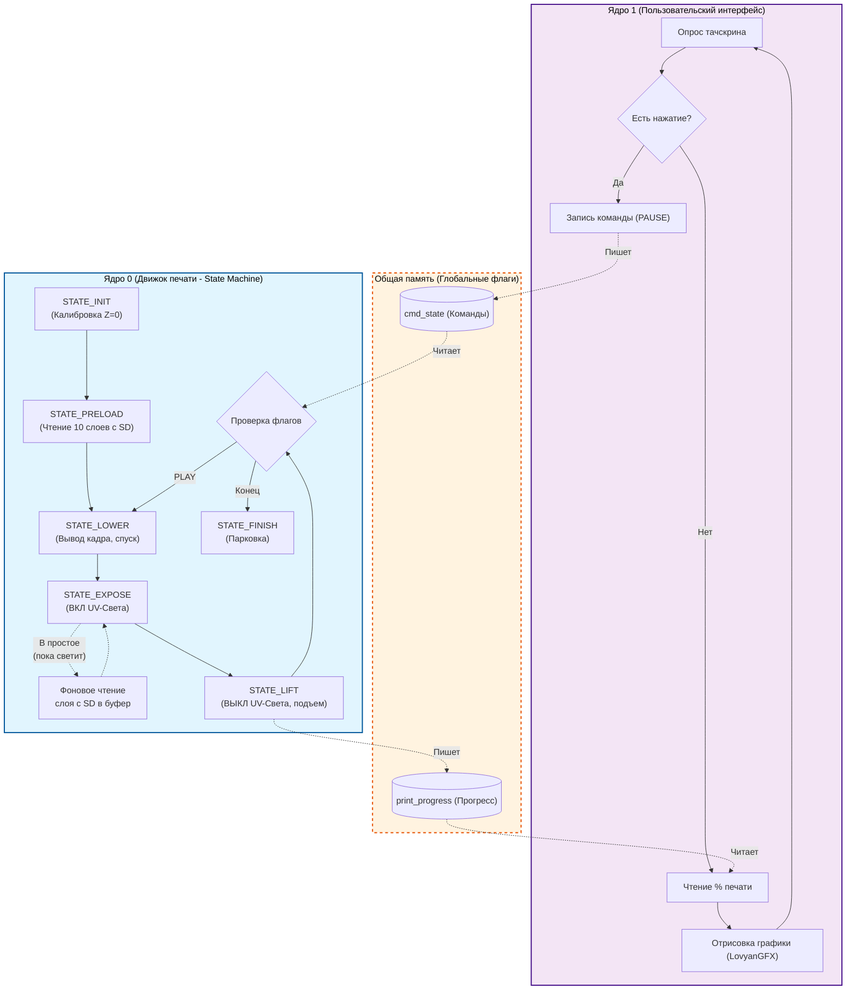

# MiniPixel Project Documentation

## Написание кода

Код для МК **ESP32-S3**, код можно писать в **Visual Studio Code** с дополнением **PlatformIO**, на данный момент тестируется и будет проверяться.
Не забываем загружать всё на GitHub, делать это через VS Code можно из коробки, главное иметь Git на компьютере, и настроить чуток ([Инструкция на Хабре](https://habr.com/ru/articles/541258/)).

| Библиотека | Документация | 
| ----- | ----- | 
| PlatformIO | 🫥 | 
| Arduino Framework | [Link](https://www.arduino.cc/reference/en/) | 
| LGFX (LovyanGFX) | [Link](https://github.com/lovyan03/LovyanGFX) | 

Код пишется под **Arduino Framework**.

## Тестирование логической схемы

Проводилось в **Proteus**, на данный момент тестирование не производится, ведется работа над принципиальной схемой устройства.

| № | Элементы | Ссылка на документацию | Комментарии | 
| ----- | ----- | ----- | ----- | 
| 1. | ESP32-S3 | [Datasheet](https://www.espressif.com/sites/default/files/documentation/esp32-s3_datasheet_en.pdf) | Основной контроллер. Логика 3.3В. | 
| 2. | DC CONVERTER LM2596 | [Datasheet](https://www.ti.com/lit/ds/symlink/lm2596.pdf) | Понижающий модуль. Настроить на 5В перед подключением. | 
| 3. | SONGLE SRD-05VDC-SL-C | [Datasheet](https://html.alldatasheet.com/html-pdf/99638/SONGLE/SRD-05VDC-SL-C/238/1/SRD-05VDC-SL-C.html) | Реле 5В. Управлять через транзистор + защитный диод. | 
| 4. | ili9488 x2 | [Datasheet](https://www.displayfuture.com/Display/Datasheet/Controller/ILI9488.pdf) | В Proteus можно использовать аналог (ILI9341). Купили новые, уже есть. | 
| 5. | Шаговый двигатель NEMA 17 (17mm) | [Specs](https://www.reprap.org/wiki/NEMA_17_Stepper_motor) | Требуется внешний драйвер **A4988**. | 
| 6. | A4988 | [Datasheet](https://www.pololu.com/file/0J450/A4988.pdf) | Драйвер шагового двигателя. VMOT от внешнего БП 12В. VDD от ESP32 3.3В. | 
| 7. | TMC2100 | [Datasheet](https://www.trinamic.com/fileadmin/assets/Products/ICs_Documents/TMC2100_datasheet.pdf) | Бесшумный драйвер шагового двигателя. | 
| 8. | UV матрица 12В | — | Управляется через реле. Ток замерить перед выбором БП. | 
| 9. | Концевой выключатель | — | Калибровка нулевой позиции оси Z (homing). | 
| 10. | Блок питания | — | 12В, 6А | 

## Схема питания

```
12В БП (≥5А)
├── → A4988 VMOT (питание мотора)
├── → UV матрица (через реле)
└── → LM2596 → 5В → ESP32 VIN
                     └── ESP32 3.3V → A4988 VDD
                                    → ILI9488 x2 VCC
```

## Подключение A4988

| A4988 | ESP32-S3 | Описание | 
| ----- | ----- | ----- | 
| STEP | GPIO1 | Импульс шага | 
| DIR | GPIO2 | Направление | 
| EN | GPIO3 | Включение (LOW = вкл) | 
| VDD | 3.3V | Питание логики | 
| GND | GND | Общая земля | 
| RST | SLP | Соединить вместе | 
| MS1/MS2/MS3 | GND | Полный шаг | 
| VMOT | 12В внешний БП | Питание мотора | 

## Подключение TMC2100

| TMC2100 | ESP32-S3 | Описание | 
| ----- | ----- | ----- | 
| GND | GND | Общая земля | 
| VIO | 3.3V | Питание логики | 
| M1B | Обмотка мотора | Выход катушки B1 | 
| M1A | Обмотка мотора | Выход катушки A1 | 
| M2A | Обмотка мотора | Выход катушки A2 | 
| M2B | Обмотка мотора | Выход катушки B2 | 
| GND | GND | Земля силовая | 
| VM | 12V БП | Силовое питание мотора | 
| DIR | GPIO | Направление вращения | 
| STEP | GPIO | Шаг (импульсы) | 
| NC | — | Не подключено | 
| NC | — | Не подключено | 
| CFG3 | GND / VIO | Настройка микрошага | 
| CFG2 | GND / VIO | Настройка микрошага | 
| CFG1 | GND / VIO | Настройка режима работы | 
| EN | GPIO | Разрешение работы драйвера (Enable) | 

## Принцип работы устройства



### Ссылки на скачку

| № | Программа | Ссылка / Инструкция | 
| ----- | ----- | ----- | 
| 1. | Visual Studio Code | https://code.visualstudio.com/download | 
| 2. | PlatformIO | https://docs.platformio.org/en/latest/integration/ide/vscode.html | 
| 3. | Git | https://git-scm.com/install/windows / https://habr.com/ru/articles/541258/ | 
| 4. | Proteus | Пираты вперёд, пока нет ссылки на нормальный файл | 
